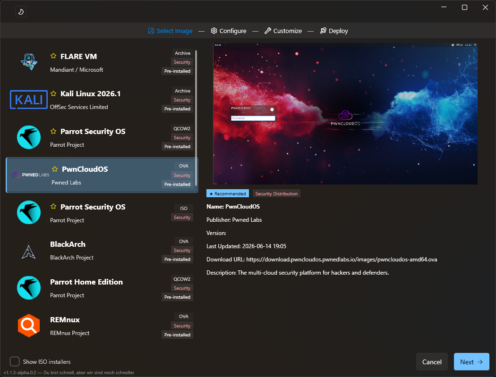

<div align="center">

# VMCreate

**Kali, Parrot, REMnux and friends on Hyper-V — in one click.**
No VirtualBox. No VMware. No manual installs.

[](../../releases/latest)
[](../../actions)
[](LICENSE.txt)


[Download](../../releases/latest) · [What it does](#what-vmcreate-does-for-you) · [CLI](#automate-it-from-the-command-line) · [Security notice](#before-you-start-security--privacy)




</div>

## Why VMCreate?

Most security distributions ship ready-made VirtualBox or VMware images and leave Hyper-V users two choices: install a second hypervisor, or spend an evening on a manual install. VMCreate gives you a third option. Pick a distribution, click **Create**, and a few minutes later you have a working, connected desktop in Hyper-V.

It replaces Hyper-V **Quick Create** with a gallery you'll actually want to use.

## What VMCreate does for you

| You'd normally have to… | VMCreate… |
|---|---|
| Find the right image, download it, verify the checksum | Downloads from the official source and **verifies SHA-256** automatically |
| Unpack `.7z` / `.xz` / `.zst`, convert QCOW2 / VMDK / OVA to VHDX | Handles every common format and converts it for you |
| Fix a BIOS-only disk so it boots as a Gen 2 UEFI VM | Migrates MBR → GPT so the VM boots under Gen 2 |
| Get networking, SSH and Hyper-V integration working in the guest | Configures the guest after first boot, then **restores distribution defaults** |
| Fight with Enhanced Session / RDP (and Wayland) | Detects X11 vs Wayland and installs a matching RDP backend (xRDP, Lamco, or WayRDP) |
| Copy your Hack The Box VPN config into the VM | Deploys your **HTB Labs / Starting Point / Academy** OpenVPN profile directly |
| Set the timezone, CPU, memory, disk size | Syncs the timezone and applies sensible defaults that you can override |

## The gallery

**Ready in one click** (disk images, no installer to click through):

| Security | General |
|----------|---------|
| Kali Linux · Parrot OS · BlackArch | Arch Linux |
| PwnCloud OS · REMnux · Whonix | Rocky Linux (Cloud) · Ubuntu |

**Also available** (ISO installers, hidden by default): Alpine, Athena OS, CAINE, Debian, Fedora, Linux Mint, NixOS, openSUSE, Pentoo, Rocky Linux, Security Onion, Tsurugi.

**Bring your own:** load images from the Microsoft gallery, a local JSON gallery, registry entries, or any cloud image URL.

## Get started

1. Enable Hyper-V on Windows 10/11.
2. Download from **[Releases](../../releases/latest)**:
   - **`vmcreate-x.y.z.msi`**: installs VMCreate in place of Hyper-V Quick Create (uninstalling restores Quick Create)
   - **`vmcreate-x.y.z.exe`**: portable, no install needed
   - **`vmcreate-cli-x.y.z.zip`**: command-line version for scripting
3. Verify the downloads against `checksums.sha256`, launch, pick a distro, click **Create**.

## Automate it from the command line

Everything the GUI does is scriptable, and the CLI adds a few things the GUI doesn't have:

```powershell
# Browse the gallery
vmcreate list --category security

# Kali with your HTB VPN, 8 GB RAM, 4 vCPUs
vmcreate create --image kali --memory 8192 --cpu 4 --htb-vpn labs

# Any cloud-init cloud image, fully unattended
vmcreate create --image-uri https://…/image.qcow2 --cloud-init user-data.yaml

# Pin it to a lab switch with a static address
vmcreate create --image ubuntu --switch LabNet --static-ip 192.168.10.50/24 --gateway 192.168.10.1
```

Run `vmcreate create --help` for the full list of options: RDP backend, desktop environment, SSH key, nested virtualization, and more.

## Before you start: security & privacy

To make Linux images that were never built for Hyper-V boot and connect, VMCreate **modifies the guest**: network configuration, firewall rules, SSH settings and boot setup. It restores distribution defaults afterwards wherever it can.

> [!WARNING]
> **If you rely on a distribution's security or privacy guarantees (Whonix, for example), don't deploy it with VMCreate.** The conversion can weaken the protections those distributions are designed to provide.

Many of these distributions aren't designed or supported by their maintainers to run on Hyper-V. See [SECURITY.md](SECURITY.md) for a guest-to-host attack-surface analysis and a comparison with VMware and Proxmox.

## Licensing

VMCreate is **MIT-licensed** and bundles no third-party RDP software.
The optional **Lamco RDP Server** backend is downloaded at deploy time and is licensed under **BSL 1.1**: free on a single VM, for non-profits, and for non-commercial education or research. Commercial use on multiple VMs requires a license from [lamco.ai](https://lamco.ai). See [THIRD-PARTY-NOTICES.md](THIRD-PARTY-NOTICES.md).

<details>
<summary><b>Building from source</b></summary>

```
dotnet build VMCreate.sln
dotnet test VMCreate.sln
dotnet publish VMCreate/VMCreate.csproj -c Release -r win-x64 --self-contained
```

Requires the .NET 10 SDK. Release builds are self-contained.
</details>
