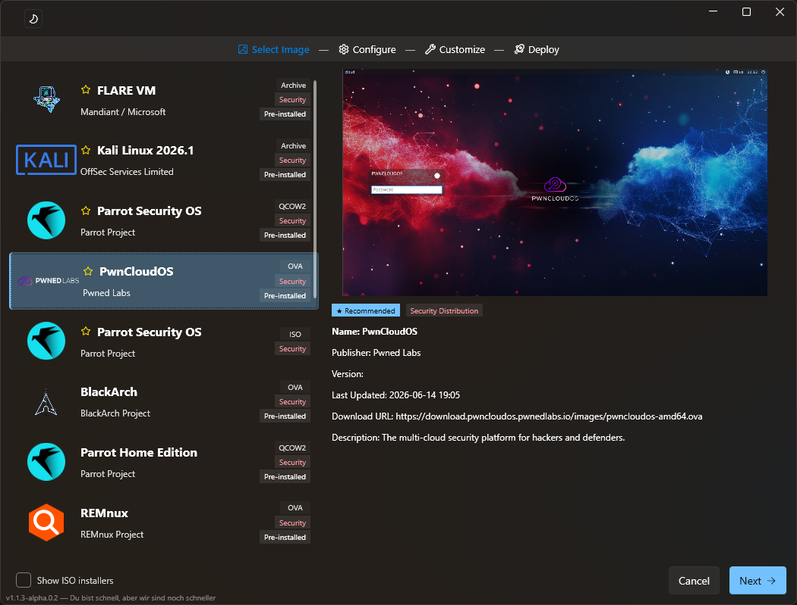

<div align="center">

# VMCreate

**Kali, Parrot, REMnux and friends on Hyper-V — in one click.**
No VirtualBox. No VMware. No manual installs.

[](../../releases/latest)
[](../../actions)
[](LICENSE.txt)


[Download](../../releases/latest) · [What it does](#what-vmcreate-does-for-you) · [CLI](#automate-it-from-the-command-line) · [Security notice](#before-you-start-security--privacy)




</div>

## Why VMCreate?

Most security distributions ship ready-made VirtualBox or VMware images and leave Hyper-V users two choices: install a second hypervisor, or spend an evening on a manual install. VMCreate gives you a third option. Pick a distribution, click **Create**, and a few minutes later you have a working, connected desktop in Hyper-V.

It replaces Hyper-V **Quick Create** with a gallery you'll actually want to use.

## What VMCreate does for you

| You'd normally have to… | VMCreate… |
|---|---|
| Find the right image, download it, verify the checksum | Downloads from the official source and **verifies SHA-256** automatically |
| Unpack `.7z` / `.xz` / `.zst`, convert QCOW2 / VMDK / OVA to VHDX | Handles every common format and converts it for you |
| Fix a BIOS-only disk so it boots as a Gen 2 UEFI VM | Migrates MBR → GPT so the VM boots under Gen 2 |
| Get networking, SSH and Hyper-V integration working in the guest | Configures the guest after first boot, then **restores distribution defaults** |
| Fight with Enhanced Session / RDP (and Wayland) | Detects X11 vs Wayland and installs a matching RDP backend (xRDP, Lamco, or WayRDP) |
| Copy your Hack The Box VPN config into the VM | Deploys your **HTB Labs / Starting Point / Academy** OpenVPN profile directly |
| Set the timezone, CPU, memory, disk size | Syncs the timezone and applies sensible defaults that you can override |

## The gallery

**Ready in one click** (disk images, no installer to click through):

| Security | General |
|----------|---------|
| Kali Linux · Parrot OS · BlackArch | Arch Linux |
| PwnCloud OS · REMnux · Whonix | Rocky Linux (Cloud) · Ubuntu |

**Also available** (ISO installers, hidden by default): Alpine, Athena OS, CAINE, Debian, Fedora, Linux Mint, NixOS, openSUSE, Pentoo, Rocky Linux, Security Onion, Tsurugi.

**Boot-only live systems:** Tails boots from its DVD and runs entirely in RAM. No disk is created, the guest is never modified, and each session starts fresh (amnesic).

**Bring your own:** load images from the Microsoft gallery, a local JSON gallery, registry entries, or any cloud image URL.

## Get started

1. Enable Hyper-V on Windows 10/11.
2. Download from **[Releases](../../releases/latest)**:
   - **`vmcreate-x.y.z.msi`**: installs VMCreate in place of Hyper-V Quick Create (uninstalling restores Quick Create)
   - **`vmcreate-x.y.z.exe`**: portable, no install needed
   - **`vmcreate-cli-x.y.z.zip`**: command-line version for scripting
   - **`vmcreate-manager-x.y.z.exe`**: portable [VMCreate Manager](#vmcreate-manager), a replacement for Hyper-V Manager (also included in the MSI)
3. Verify the downloads against `checksums.sha256`, launch, pick a distro, click **Create**.

## Automate it from the command line

Everything the GUI does is scriptable, and the CLI adds a few things the GUI doesn't have:

```powershell
# Browse the gallery
vmcreate list --category security

# Kali with your HTB VPN, 8 GB RAM, 4 vCPUs
vmcreate create --image kali --memory 8192 --cpu 4 --htb-vpn labs

# Any cloud-init cloud image, fully unattended
vmcreate create --image-uri https://…/image.qcow2 --cloud-init user-data.yaml

# Pin it to a lab switch with a static address
vmcreate create --image ubuntu --switch LabNet --static-ip 192.168.10.50/24 --gateway 192.168.10.1
```

Run `vmcreate create --help` for the full list of options: RDP backend, desktop environment, SSH key, nested virtualization, and more.

## VMCreate Manager

**VMCreate Manager** (`VMCreate.Manager.exe`) replaces the Hyper-V Manager MMC snap-in for day-to-day work:

- **Folders and tags.** Drag VMs into folders, nest folders, and tag VMs. Built-in views show running, protected and expired VMs, and VMs that aren't in any folder.
- **Purpose, description and expiry date** for each VM, so you remember what a lab box is for and when it can go.
- **Delete protection.** Mark a VM as protected and VMCreate tools refuse to delete it. Protection only applies inside VMCreate's own tools: it can't stop `Remove-VM` or Hyper-V Manager.
- **Live console preview** of the selected VM, updated every two seconds. Click it to connect.
- **Search** across name, purpose, tags, description and IP address, plus **bulk actions**: start, shut down, turn off, save, pause, resume.
- **One-click SSH**, over the network or over vsock. Vsock needs no guest networking, so it works for isolated lab VMs.
- **Credentials** stored encrypted with Windows DPAPI. Older VMCreate versions wrote them into the VM's Notes in plain text; the Manager offers to move them into the encrypted store.
- **Delete a VM with its disks.** A preview lists every file with its size and says why it goes or stays. Disks another VM still uses (a template's base disk, for example) are kept, and so are ISOs outside the VM's own folders. Protected VMs, running VMs and templates that still have clones can't be deleted. Files go to the Recycle Bin unless you choose otherwise, and you confirm by typing the VM's name.
- **Templates and linked clones.** Mark a VM as a template, then create clones whose disks are differencing disks on top of the template's. A template must have no checkpoints.
- **Network exposure.** Each VM shows whether it reaches an external network, the host, or only other VMs. **Isolate now** disconnects every adapter and **Restore** reconnects exactly those adapters.
- **Engagement folders with an expiry date.** Expired VMs get a reminder banner and their own view. Nothing is ever deleted automatically.
- **Archive a folder.** Exports every VM in the folder (configuration, checkpoints, disks) with a `manifest.json` that holds the metadata and a SHA-256 checksum per file. Linked clones include their parent disk, so each export imports on its own. Afterwards you can delete the archived VMs. A running archive can be cancelled; VMs that were already exported stay in the archive.
- **Storage.** Shows disk use per drive and per VM (own disks vs. disks shared with clones), and checkpoints older than a number of days you choose. It also lists:
  - unused files: virtual disks, ISOs and VM configuration files that no VM or checkpoint uses, plus empty leftover VM folders;
  - files that VMs refer to but that are missing.

  Before deleting, the host is scanned again, and anything a VM uses by then or that changed is left alone. The scan skips disks belonging to WSL, Docker and Windows Sandbox, files another program has open, and archives made by the Manager.
- **Activity log.** Every create, delete, archive, network and folder change is appended to `%LOCALAPPDATA%\VMCreate\Manager\audit.jsonl`. The log records who made the change, when and with which tool. VMCreate logs the VMs it creates there too.

Your metadata lives in `%LOCALAPPDATA%\VMCreate\Manager\metadata.json`. A copy, without credentials, is kept in each VM's Hyper-V Notes, so folders, tags and descriptions travel with exported VMs and come back if the file is lost. If you edit that `[vmcreate]` block in Hyper-V Manager or with `Set-VM -Notes`, the Manager takes your edit over at the next refresh and records it in the activity log. The exception is the protected flag: an outside edit can turn it on but not off. Metadata of VMs removed outside the Manager is listed under Storage → Old metadata, where you can remove it. The Manager runs without elevation if your account is a member of **Hyper-V Administrators**.

The MSI installs it next to VMCreate with its own Start menu entry; `vmcreate-manager-x.y.z.exe` is the portable version.

## Before you start: security & privacy

To make Linux images that were never built for Hyper-V boot and connect, VMCreate **modifies the guest**: network configuration, firewall rules, SSH settings and boot setup. It restores distribution defaults afterwards wherever it can.

> [!WARNING]
> **If you rely on a distribution's security or privacy guarantees (Whonix, for example), don't deploy it with VMCreate.** The conversion can weaken the protections those distributions are designed to provide.

Many of these distributions aren't designed or supported by their maintainers to run on Hyper-V. See [SECURITY.md](SECURITY.md) for a guest-to-host attack-surface analysis and a comparison with VMware and Proxmox.

## Licensing

VMCreate is **MIT-licensed** and bundles no third-party RDP software.
The optional **Lamco RDP Server** backend is downloaded at deploy time and is licensed under **BSL 1.1**: free on a single VM, for non-profits, and for non-commercial education or research. Commercial use on multiple VMs requires a license from [lamco.ai](https://lamco.ai). See [THIRD-PARTY-NOTICES.md](THIRD-PARTY-NOTICES.md).

<details>
<summary><b>Building from source</b></summary>

```
dotnet build VMCreate.sln
dotnet test VMCreate.sln
dotnet publish VMCreate/VMCreate.csproj -c Release -r win-x64 --self-contained
dotnet publish VMCreate.Manager/VMCreate.Manager.csproj -c Release -r win-x64 --self-contained
```

Requires the .NET 10 SDK. Release builds are self-contained.
</details>
